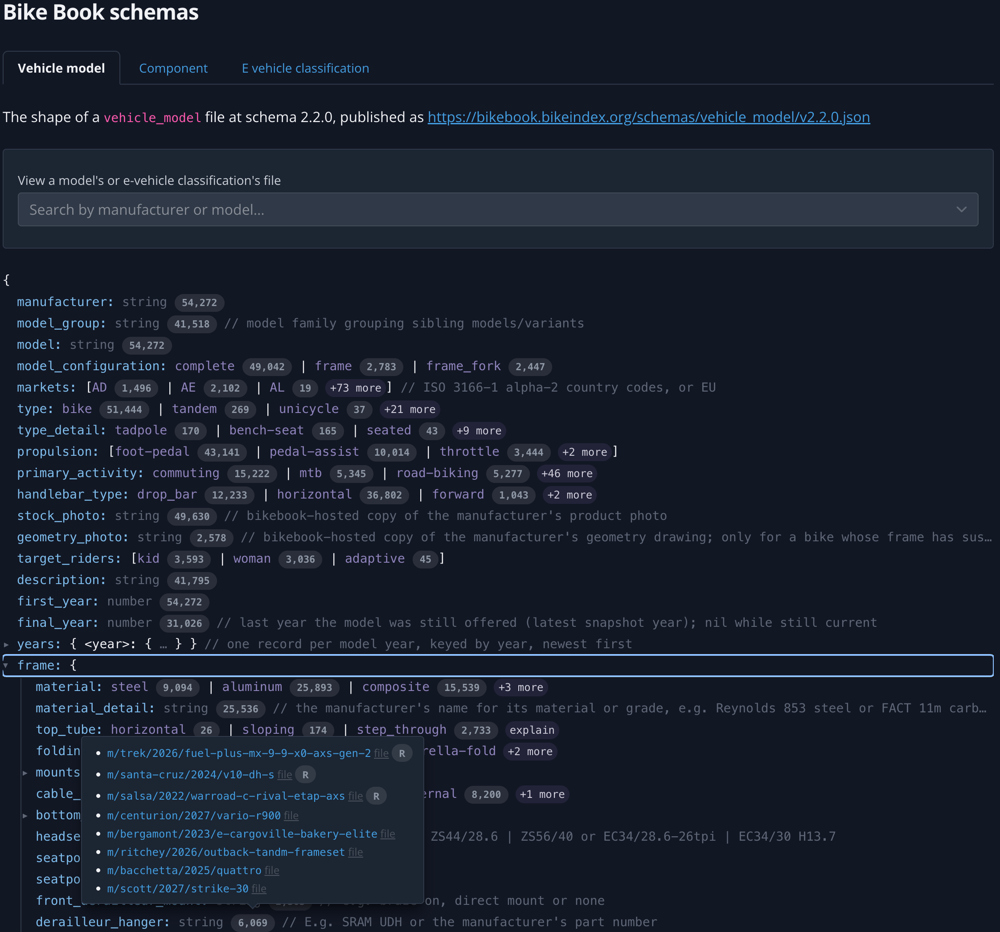

#  [Bike Book](https://bikeindex.org/bikebook)

Compare bikes, e-bikes and e-Personal Mobility Devices (aka EPAMD). Check out the viewer at [bikeindex.org/bikebook](https://bikeindex.org/bikebook).

## What?

Bike Index created an open source repository of all the bike (and e-bike, trike, EPAMD, etc, hereafter just referred to as "bike") data.

Bikes are surprising complex and have a myriad of conflicting options, so we needed a data format. Explore the current JSON Schema at [bikeindex.org/bikebook_schema](https://bikeindex.org/bikebook_schema):



The schema viewer helps make sense of the structure by including comments and showing the number of matching bikes along with links to sample bike IDs.

There are always things to improve in the data model - see [Issue #43](https://github.com/bikeindex/bikebook/issues/43) for some things we hope to work on (and please comment with things we're missing).

## But the files

This repository is a flat file database. The data is stored in JSON files.

The 2026 `Fuel+ MX 9.9 X0 AXS Gen 2` by Trek has this id: `m/trek/2026/fuel-plus-mx-9-9-x0-axs-gen-2`

Which is in this repository at [vehicle_models/trek/2026/fuel-plus-mx-9-9-x0-axs-gen-2.json](vehicle_models/trek/2026/fuel-plus-mx-9-9-x0-axs-gen-2.json)

**The model IDs are `<maker>/<year>/<model name>.json`** and the files are at that path in `vehicle_models/`

You can convert `<maker>` and `<model>` to slugs with this JS:


```js
const slugify = (s) => Array.from(String(s ?? "").replace(/\([^)]*\)/g, "").replaceAll("%20", " ").replace(/&(apos|amp|quot|gt|lt|#[0-9]+|#[xX][0-9A-Fa-f]+);/g, (m, e) => e[0] !== "#" ? { amp: "&", quot: '"', apos: "'", lt: "<", gt: ">" }[e] : ((n) => n < 0x10ffff ? String.fromCodePoint(n) : m)(/x/i.test(e[1]) ? parseInt(e.slice(2), 16) : parseInt(e.slice(1), 10))).replace(/['’‘`´]/g, "").toLowerCase(), (c) => c < "\x80" ? c : (" àa áa âa ãa äa åa æae çc èe ée êe ëe ìi íi îi ïi ðd ñn òo óo ôo õo öo øo ùu úu ûu üu ýy þth ßss ÿy āa ăa ąa ćc ĉc ċc čc ďd đd ēe ĕe ėe ęe ěe ĝg ğg ġg ģg ĥh ħh ĩi īi ĭi įi ıi ijij ĵj ķk ĸk ĺl ļl ľl ŀl łl ńn ņn ňn ʼn'n ŋng ōo ŏo őo œoe ŕr ŗr řr śs ŝs şs šs ţt ťt ŧt ũu ūu ŭu ůu űu ųu ŵw ŷy źz żz žz ǫo ǭo ×x ".match(` ${c}(\\S+) `) ?? [, "?"])[1]).join("").replaceAll("&", " and ").replaceAll("+", " plus ").match(/[a-z0-9]+/g)?.join("-") ?? ""

// Then run it like this:

slugify('Fuel+ MX 9.9 X0 AXS Gen 2') // 'fuel-plus-mx-9-9-x0-axs-gen-2'
```


<details>
<summary>Full slug explanation</summary>

Slugifying does this:

1. Drops parentheticals and turn `%20` into a space
2. Decodes HTML entities like `&amp;`
3. Deletes apostrophes, so "Bob’s" becomes bobs, not bob-s.
4. Lowercases, then swaps accented letters for plain ones (ß → ss, æ → ae).
5. Turns & into "and" and + into "plus".
6. Joins the remaining runs of letters and digits with hyphens.

Expanded, readable JS:

```js
// I18n::Backend::Transliterator::HashTransliterator::DEFAULT_APPROXIMATIONS, lower-case entries only (the
// text is downcased first). Any other non-ASCII character becomes "?" in Rails, so it separates words here too.
const APPROXIMATIONS = Object.fromEntries(
  ("àa áa âa ãa äa åa æae çc èe ée êe ëe ìi íi îi ïi ðd ñn òo óo ôo õo öo øo ùu úu ûu üu ýy þth ßss ÿy " +
    "āa ăa ąa ćc ĉc ċc čc ďd đd ēe ĕe ėe ęe ěe ĝg ğg ġg ģg ĥh ħh ĩi īi ĭi įi ıi ijij ĵj ķk ĸk ĺl ļl ľl ŀl łl " +
    "ńn ņn ňn ʼn'n ŋng ōo ŏo őo œoe ŕr ŗr řr śs ŝs şs šs ţt ťt ŧt ũu ūu ŭu ůu űu ųu ŵw ŷy źz żz žz ǫo ǭo")
    .split(" ")
    .map((pair) => [pair[0], pair.slice(1)])
)
APPROXIMATIONS["×"] = "x"

// CGI.unescapeHTML: the five named entities and numeric ones
const ENTITIES = { amp: "&", quot: '"', apos: "'", lt: "<", gt: ">" }
const unescapeHTML = (text) =>
  text.replace(/&(amp|quot|apos|lt|gt|#\d+|#x[0-9a-f]+);/gi, (match, entity) => {
    if (entity[0] !== "#") return ENTITIES[entity.toLowerCase()] ?? match
    const code = entity[1].toLowerCase() === "x" ? parseInt(entity.slice(2), 16) : parseInt(entity.slice(1), 10)
    return code <= 0x10ffff ? String.fromCodePoint(code) : match
  })

const transliterate = (text) =>
  Array.from(text, (character) =>
    character.charCodeAt(0) < 128 ? character : APPROXIMATIONS[character] ?? "?"
  ).join("")

export function slugify(string) {
  const text = String(string ?? "")
    .replace(/\([^)]*\)/g, "") // parentheticals are dropped
    .replaceAll("%20", " ")
  const words = transliterate(unescapeHTML(text).replace(/['’‘`´]/g, "").toLowerCase())
    .replaceAll("&", " and ")
    .replaceAll("+", " plus ")
    .match(/[a-z0-9]+/g)
  return (words ?? []).join("-")
}
```

</details>


## Versioning

schema version is semantic:

- Major versions remove, rename or retype a field, remove an enum value or add a new required field
- Minor ones add an optional field or an enum value
- Patches changes only descriptions.

## Catalog

These files are all used to generate a manifest and catalog. The manifest lists all the files, the catalog is published by [bikebook_ci](https://github.com/bikeindex/bikebook_ci) (which also is where the tests are). This is what is used by the viewer to render the data.

The published catalog's format is versioned apart from it, one integer raised whenever the layout of its files changes.

## Contributing

Please submit any fixes that you have! See [CONTRIBUTING](CONTRIBUTING.md): contributors sign our [Contributor License Agreement](https://cla-assistant.io/bikeindex/bikebook) before their first pull request is merged.

---

© Bike Index and Bike Book contributors.

Read about the license and attribution at [bikeindex.org/bikebook/license](https://bikeindex.org/bikebook/license).

The data in this repository is licensed under a <a rel="license" href="http://creativecommons.org/licenses/by-sa/4.0/">Creative Commons Attribution-ShareAlike 4.0 International License</a>.

Product descriptions (the `description` of vehicle models and components) and photos (`stock_photo`, `geometry_photo`) belong to their manufacturers and aren't covered by CC BY-SA. They're included to identify the products, and we'll remove any on request: email licensing@bikeindex.org.

<a rel="license" href="http://creativecommons.org/licenses/by-sa/4.0/"></a>

The data is provided as is, without warranties of any kind. E-vehicle classification, certification and legality information is general guidance, not legal advice: laws vary by country, state, city and campus and change over time, so check local rules and the manufacturer's documentation before relying on them.
